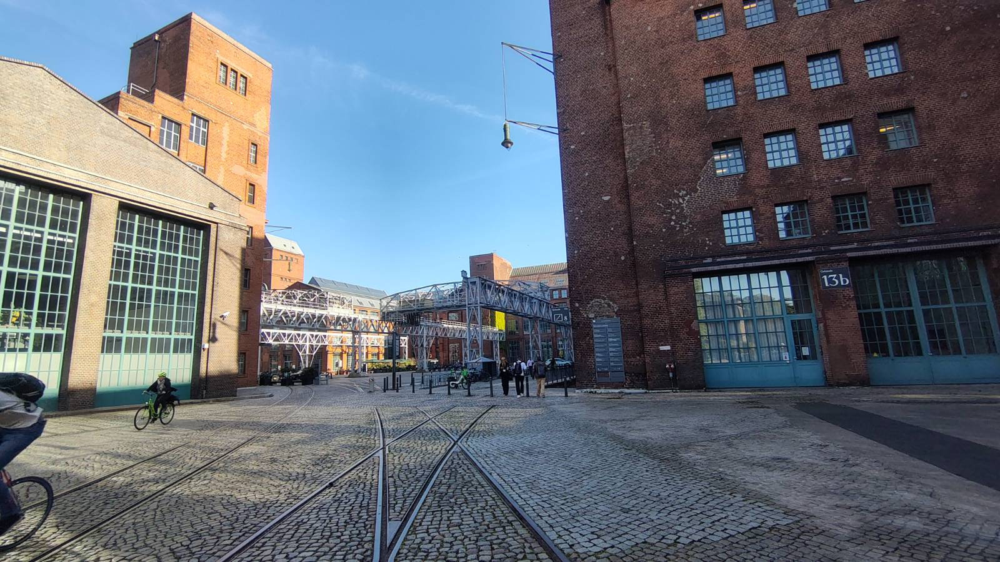

Five days in Berlin for [ECEE 2026](https://ecee2026.eu/), and what lingers is not a talk but a feeling of unease.
Not because of the science: the science was excellent. Professor Cotton's keynote on ground-motion models in the age of big data was among the most stimulating talks I have heard in a while, and Professor Vamvatsikos confirmed once again his gift for metaphors that are daring and yet pedagogically flawless (I deeply regret never having sat in one of his classes as a student).

And yet, wandering through the scattered halls of TU Berlin, I felt something I had never felt at a conference before: estrangement. As if we were discussing everything except the elephant in the room. As if each of us were carrying on with the profession while pretending not to notice what is looming over it. Maybe it is partly where I stand with academia. Not entirely for sure.

## The elephant

A few days earlier, [OpenAI had released a proof on Navier-Stokes](https://openai.com/index/navier-stokes-solution/), one of the Millennium Prize Problems, produced by some 10,000 agents working in parallel. I could not follow it beyond the first lines of the abstract, it still awaits scrutiny by mathematicians, and it has sparked a dispute over credit. But try to picture them: 10,000 Ph.D. students working together and talking to each other with perfect efficiency, no pointless meetings, no unanswered texts, no rivalries. I cannot. At ECEE 2026, the main European gathering in earthquake engineering, there were about a thousand of us, ten times fewer.

If agents can take on a Millennium Prize problem, what about us? Let us be honest: much of works we present at conferences like this one is numerical, and almost every step of that [workflow](https://www.anthropic.com/engineering/building-effective-agents) can already be delegated:

* surveying the literature to identify open problems;
* judging which of them are tractable (and important);
* designing the numerical experiment;
* generating the data;
* writing the paper.

Richard Hamming reminded us that ["the purpose of computing is insight, not numbers."](https://en.wikiquote.org/wiki/Richard_Hamming#:~:text=The%20purpose%20of%20computing%20is%20insight%2C%20not%20numbers) The uncomfortable question is what remains for us when the machine delivers both.

## First refuge: the laboratory

The obvious answer is experimental work. Slow, expensive and unglamorous, it has been sidelined for years by an [academic economy that rewards volume](https://doi.org/10.1038/d41586-025-03623-2). Perhaps it becomes our last stronghold.

But the machine would design the experiment too. We would be left as the material executors of tests conceived elsewhere, producing data on how the world works so that it can be fed to something that understands it on our behalf. How would that differ from any production line? The product is no longer a car or a chair, but a measurement. In 1848 Marx described the worker who becomes ["an appendage of the machine."](https://thenewobjectivity.com/pdf/marx.pdf) He had textile mills in mind, not shake tables.

## Second refuge: the lecture hall

Then there is teaching, the other pillar of the university, which on this side of the ocean has also been pushed into the background by the same [bulimia of scientific production](https://doi.org/10.1162/qss_a_00327). Perhaps the academy will return to something closer to its eighteenth-century form: theory, conversation, teaching. Perhaps we will even put the [gowns back on to cross the campus.](https://static0.srcdn.com/wordpress/wp-content/uploads/2022/06/Sherlock-Holmes-meeting-Jared-Harris-as-Moriarty-in-Sherlock-Holmes-A-Game-Of-Shadows.jpg?q=50&fit=crop&w=825&dpr=1.5)

But that academy was also deeply elitist. If the production of knowledge is automated, does the university become a luxury, a quiet place where a privileged few contemplate what the machines have found? Is that a renaissance or a retreat?

## Third option: adapt

Discussing some of this thoughts with a CS professor at my university, the conclusion was a familiar one: jobs will be lost by those who fail to adapt, as with the steam engine, the internal combustion engine and computers?

Perhaps. But those technologies extended our hands and accelerated our arithmetic. This one targets the step we always considered ours: deciding which questions are worth asking. The weaver who adapted to the power loom still knew what cloth was for. Will we still know what our papers are for?

 

In [*The Leopard*](https://en.wikipedia.org/wiki/The_Leopard), Tancredi warns: ["Things will have to change in order that they remain the same."](https://en.wikiquote.org/wiki/The_Leopard#:~:text=Things%20will%20have%20to%20change%20in%20order%20that%20they%20remain%20the%20same) Academia seems to have read the line backwards: everything is changing, and we keep presenting as if nothing had.
Maybe at the next ECEE the elephant will get its own session. It will probably have written the abstract itself.

    
P.S. A few weeks later came the confirmation: [OpenAI is giving mathematics a thorough beating](https://www.theguardian.com/technology/2026/oct/07/openai-mathematical-findings-concerns). [The queen of the sciences](https://en.wikiquote.org/wiki/Carl_Friedrich_Gauss#:~:text=Mathematics%20is%20the%20queen%20of%20the%20sciences), as Gauss called it, falls first, perhaps precisely because she is the more rigouros: no laboratories, no construction sites, only symbols and a proof checker that drink too much coffee. Next come the disciplines further down the ladder of abstraction: physics, chemistry, mechanics... and structural engineering? When will our turn come? Or, more honestly: are we sure it has not come already, and we are simply waiting for the next shock to notice?

More to read about it: [Is AI the end of math as we know it?](https://www.quantamagazine.org/is-ai-the-end-of-math-as-we-know-it-20261005/)

<iframe data-testid="embed-iframe" style="border-radius:12px" src="https://open.spotify.com/embed/episode/1KwRO8MPsAFMzKrMMvRVqh/video?utm_source=generator&si=29996c7022094d70" width="496" height="279" frameBorder="0" allowfullscreen="" allow="autoplay; clipboard-write; encrypted-media; fullscreen; picture-in-picture" loading="lazy"></iframe>