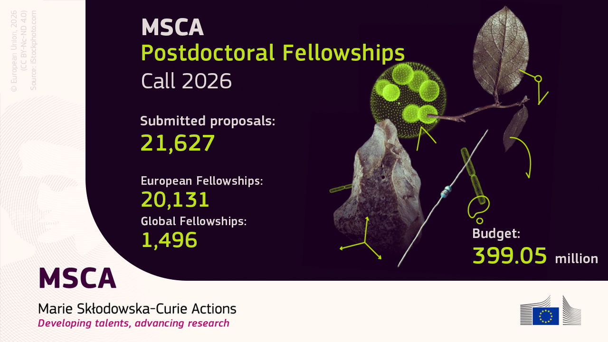

It is no secret that this year I resubmitted my MSCA Postdoctoral Fellowship proposal. Unfortunately, it does not reflect what is happening in the world right now, something I touched on briefly [in my previous post](../2026-ecee-science-w-agents/) and plan to come back to here soon. Still, the resubmission left me with a thought I cannot shake off.

I am fairly confident that almost every proposal submitted this year went through a large language model at some point. Not a model running quietly on the applicant's laptop, but one running on someone else's servers. If that is true, the companies operating those servers hold something no funding agency has ever had: the complete library of proposals for one of Europe's most competitive research programmes, and probably for every other grant call open in the same months.

While rewriting my own proposal (and no, I did not let agents loose on it), I was struck by how much these tools had changed in a single year. Part of it is surely me: I am more fluent with them, I know what to ask and when to stop trusting the answer. But the difference was too large to be explained by my learning curve alone. The models themselves are simply much better than they were twelve months ago.

That observation opens three questions, related but distinct. Before getting to them, a disclaimer.

> I am not an expert in digital privacy, let alone in the inner workings of language models. Like most posts on this blog, what follows is a personal rant: the kind of opinion I would give at the bar, if only I knew enough about football to talk about anything else there. This is one of the reasons I love scientific conferences: at dinner, I can go on about these things and nobody thinks I am mad. How I will miss conferences.

## 1. Then why not let the machine evaluate?

The current rules are asymmetric. Applicants to Horizon Europe may use generative AI to prepare their proposals, provided they disclose it and take full responsibility for the content. Expert evaluators, on the other hand, must not delegate the evaluation to AI tools, and the Commission warns them that feeding proposals into online tools may breach the confidentiality requirements of their contract. The reasoning is sound. It is also slightly ironic, since in many cases the confidential text has already been read by a model long before any human evaluator opens it.

So let me ask the provocative question. If proposals are written with the help of a machine, why not have them scored by one? Peer review carries well-known biases: towards prestigious institutions, familiar names, fashionable topics, and the reviewer's own line of research. A model applied to every proposal with the same instructions would at least be consistent. It would not be tired by the fortieth proposal, it would not be a competitor of the applicant, and it would not be in a bad mood because its own grant was rejected the week before.

The obvious objection is that we do not know how a language model "thinks". Its judgement is opaque, sensitive to phrasing, and hard to predict. All true. But are we really sure we know how a human reviewer thinks? Anyone who has received three reports on the same manuscript, one enthusiastic, one lukewarm and one openly hostile, knows that human judgement is not exactly a transparent process either. We tolerate its opacity because it is familiar, and because there is a name attached to the responsibility. Perhaps the real question is not which evaluator is more objective, but which kind of unpredictability we are willing to accept.

## 2. Who else read my proposal?

The privacy issue goes well beyond the final PDF. Whoever runs these models does not only see the submitted proposal: they potentially see the entire process that produced it. The early brainstorming, the half-formed ideas discarded after ten minutes, the help with the literature search, the attempts at a work plan, the risk table rewritten five times, and finally the polishing of every sentence until it sounds the way its human author likes. A single proposal is a snapshot of where a field might be heading in the next two or three years. Thousands of them, together with the reasoning behind them, form a remarkably detailed map of the future of European research. I am not suggesting that anyone is reading them; I have no evidence of that, and providers have their own data policies. But the map exists, and it is not held by us. Nor is this a purely theoretical concern: how conversations with these services are stored and used has [already become an issue... maybe](https://doi.org/10.1038/d41586-026-02910-w).

The natural answer is to run models locally. It would be the same logic I have followed for years with my files: instead of a commercial cloud, they live on a hard disk attached to a Raspberry Pi at home. The [Commission's own 2024 guidelines on generative AI in research](https://research-and-innovation.ec.europa.eu/news/all-research-and-innovation-news/guidelines-responsible-use-generative-ai-research-developed-european-research-area-forum-2024-03-20_en) already encouraged institutions to adopt locally hosted tools, or cloud tools they govern themselves, whenever possible. So I tried. For a few weeks I have been experimenting with a Mixture-of-Experts (MoE) model on my own machine (for the most curious, [this one](https://arxiv.org/abs/2508.10925) 🙂). On paper, MoE architectures are friendly to modest hardware, since only a fraction of the parameters is active for each token. In practice, all the experts still have to sit somewhere in memory, and on my hardware that somewhere is mostly not a GPU. The result works, technically. It is also so slow that using it for something like a proposal, where you iterate dozens of times on a single paragraph, is exhausting. You type a question, go make a coffee, come back, and it is still working on the second sentence, while the computer fan makes you feel like you are standing next to a runway.



Purpose-built hardware would solve the problem, and for a research group it may well be an excellent investment. For me, with personal funds, it is not an option right now. A rough calculation: a machine capable of running such models at a usable speed costs about as much as 250 months of a commercial subscription. That is more than twenty years. Who knows what the world will look like in twenty years. I am sure a ThinkPad T60, which is exactly twenty years old this year, would still boot today. But would any of you use it every day?

## 3. What is an idea worth now?

The third question is the one that bothers me most, and it connects directly to what I wrote after ECEE. The MSCA Postdoctoral Fellowship is, in essence, a bet on a person and an idea: an individual researcher with an original, innovative but feasible project, to be carried out largely on their own in two years. For a long time the idea was the scarce resource. You got there by reading paper after paper, noticing what was missing, discarding what had already been done or could not be done with the time and means available, until you found a gap that was both worth filling and actually fillable.

This is precisely the workflow agents are getting good at: scanning the literature, mapping open problems, judging feasibility, drafting a work plan. I did not use them for my proposal, but I have little doubt that others did, and that next year many more will. If an agent can produce a dozen credible project ideas in an afternoon, the idea stops being scarce. What remains? Perhaps the ability to choose among them, the judgement that recognizes which of the twelve deserves two years of one's life. Perhaps the execution. Perhaps simply the person, which is what the fellowship claims to fund anyway. Or perhaps a funding scheme built around the scarcity of good ideas will have to rethink what it is actually rewarding.

  
Put together, these three thoughts describe a strange situation. We have handed our ideas, and the very process by which we form them, to a handful of companies, while forbidding evaluators from doing the same for the sake of confidentiality. We could keep those ideas at home, but only by buying hardware that a postdoc cannot afford. And the ideas themselves are getting cheaper to produce every month.

I do not have a solution, and I am not even sure these are the right questions. But it would be nice if the academic community as a whole, from funding agencies to universities and journals, had guidance on this written by someone who actually knows what they are talking about. Until then, I will keep playing with local models, and keep using the server-based ones for the real work. The latter are changing the way I think in front of a computer, but that is material for another post coming soon.
