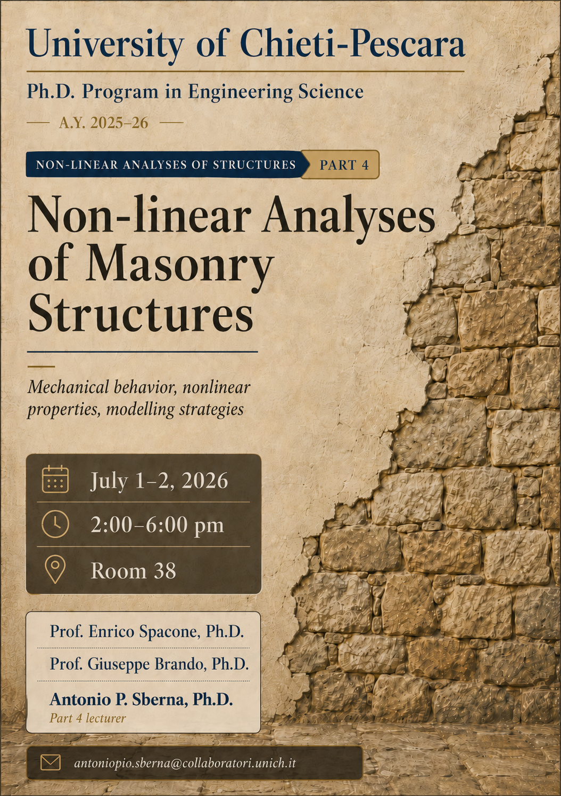
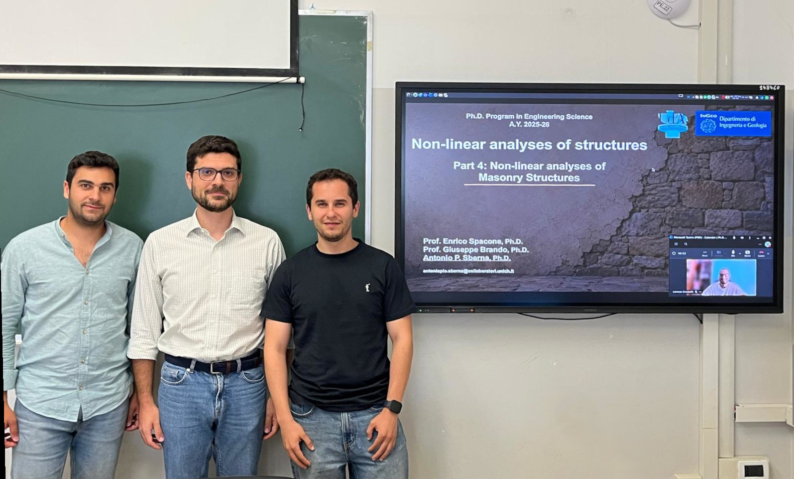

  

## Course description

The course introduces the nonlinear behaviour and numerical modelling of masonry structures, from material heterogeneity and failure mechanisms to constitutive properties and modelling strategies. It covers micro-, macro-, equivalent-frame, and discrete approaches, with a final focus on masonry infills and their interaction with reinforced concrete frames.

## Links

- [Course timetable](https://www.ingeo.unich.it/documenti/__0__uda/__12729__ingeo/__12731__corsi_dottorato/__16535__dottorato_in_engineering_science/Timetable_41_ciclo_v3.pdf)
- [Official short program](https://www.ingeo.unich.it/documenti/__0__uda/__12729__ingeo/__12731__corsi_dottorato/__16535__dottorato_in_engineering_science/Training_activities_PhD_Engineering_Science_C41.pdf)
- [Detailed program](nonlin_masonry_program_2026.pdf)

  

## Final questionnaire

The questionnaire will remain open until 9 July 2026.
Estimated completion time: approximately two minutes.